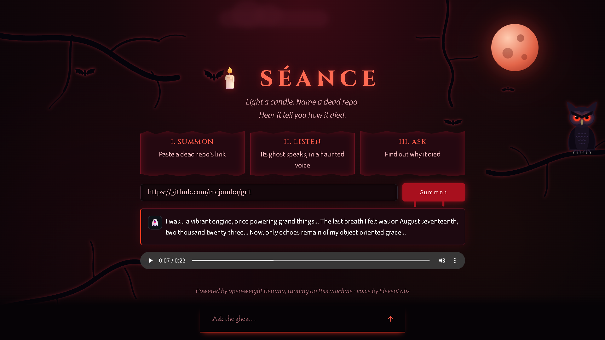
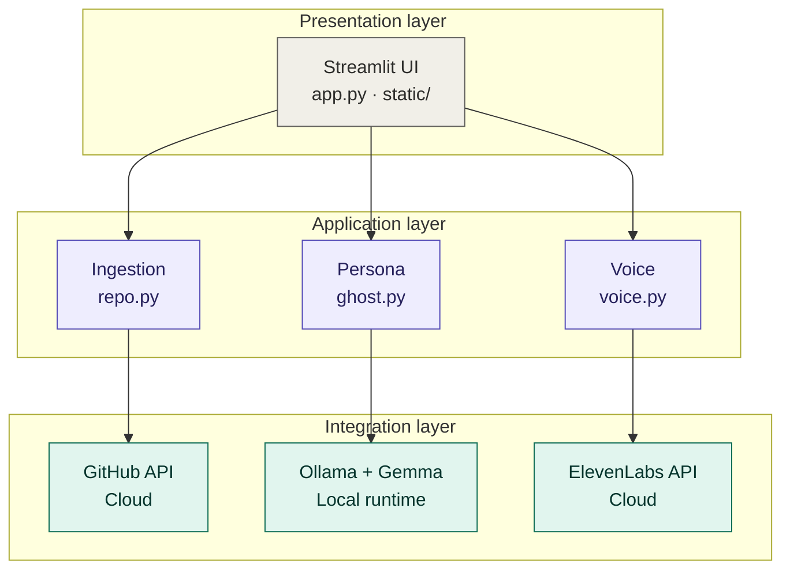

<div align="center">

# 🕯️ Séance

**Summon the ghost of an abandoned GitHub repo.**

Paste a dead repo's link and its ghost speaks to you in a haunted voice, telling you how it died. Then you can ask it anything.

Everything runs on your own machine: an open-weight Gemma model does the thinking, and ElevenLabs gives the ghost its voice.

**Built for the DEV Hacktoberfest Open-Source AI Challenge, Week 4: Ghost in the Machine**



</div>

---

## How it works

1. You paste a GitHub repo URL.
2. Séance reads the repo through the GitHub API: the description, README, open issues, recent commits, stars and last push date.
3. That becomes the ghost's "memories". A local Gemma model plays the dead repo in first person, using only those facts.
4. The reply is sent to ElevenLabs for a whispery voice, then run through a small reverb and low drone so it sounds like it's coming from a crypt.
5. You can keep chatting. The ghost remembers the whole conversation.

## Architecture



| File | What it does |
|---|---|
| `app.py` | The Streamlit page: layout, form, chat loop |
| `src/repo.py` | Fetches and trims repo info from the GitHub API |
| `src/ghost.py` | Builds the ghost's prompt and talks to Ollama |
| `src/voice.py` | Calls ElevenLabs, then adds the crypt reverb and drone |
| `static/style.css` | All the styling: blood-red theme, animations |
| `static/background.html` | The background scene: moon, clouds, branches, owl, bats |

## Project structure

```
seance/
├── app.py                  entry point
├── requirements.txt
├── .env.example            key name only, no real value
├── src/
│   ├── repo.py             GitHub ingestion
│   ├── ghost.py            persona and Ollama call
│   └── voice.py            ElevenLabs and audio effects
├── static/
│   ├── style.css
│   └── background.html
└── assets/
    └── screenshot.png
```

## Tech stack

- **Gemma** (open-weight, via [Ollama](https://ollama.com)) for the ghost's brain
- **ElevenLabs** for text-to-speech
- **Streamlit** for the UI
- **Python** with `requests` and `numpy`

## Why open models matter here

- **It runs offline.** The ghost's brain lives on your laptop. No API bill, no rate limits, and it keeps working without the internet (the voice is the only part that calls out).
- **Your data stays with you.** The repo text goes to a local model, not a third party's server, so it's safe to point at a private repo.
- **You can swap the model.** Change one line in `src/ghost.py` and a different open model plays the ghost.

## Run it yourself

You'll need Python 3.10+, [Ollama](https://ollama.com), and a free [ElevenLabs](https://elevenlabs.io) account.

**1. Clone the repo**

```
git clone https://github.com/mauryasagar/seance.git
cd seance
```

**2. Get a Gemma model**

```
ollama pull gemma4:e4b
```

If you use a different model, change `MODEL` at the top of `src/ghost.py`.

**3. Create a virtual environment and install packages**

```
python -m venv .venv
.venv\Scripts\activate
pip install -r requirements.txt
```

On macOS or Linux, activate with `source .venv/bin/activate` instead.

**4. Add your ElevenLabs key**

Copy `.env.example` to a new file named `.env` and fill it in:

```
ELEVEN_API_KEY=your_key_here
```

The key needs **Text to Speech** access. Free accounts work, but only with the built-in voices (library voices need a paid plan).

**5. Start it**

```
streamlit run app.py
```

Open `http://localhost:8501`, paste a repo link (try `https://github.com/mojombo/grit`) and press **Summon**.

## License

MIT
